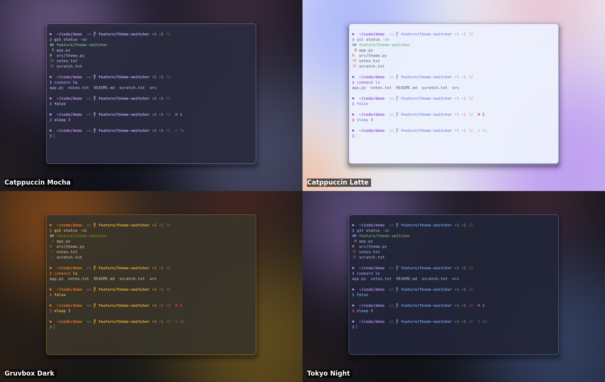

# ai-os

Setup scripts and configs that make a CachyOS laptop look and work like an AI-centric OS: a keyboard-driven
Hyprland desktop (in the spirit of Omarchy) themed as one system, with coding agents, a sandbox and quick
note capture wired in. Plasma stays installed as the fallback session.

> **This is one person's machine setup, not a general installer.** It targets CachyOS (Arch) on an AMD laptop
> (Ryzen 7 7840U / Radeon 780M, 1920x1200). Read the scripts before running them, and expect to adapt paths,
> monitors and packages. Nothing here runs `sudo` for you.



## What you get

- **Desktop**: Hyprland (Lua config), waybar, fuzzel, mako, swayosd, hyprlock/hypridle, hyprpaper, screenshots with annotate, clipboard history, touchpad gestures.
- **One theme everywhere** (`ai-os-theme`): Catppuccin Mocha/Latte, Gruvbox, Tokyo Night. Switching recolours the bar, launcher, notifications, terminal, tmux, neovim, btop, lazygit, GTK/Qt, a generated wallpaper and the fish prompt.
- **Agents**: Claude Code scratchpad on a hotkey, one git worktree + tmux window per agent, a rootless-podman sandbox (`ai-os-sandbox`), neovim integration, shared MCP servers.
- **Notes**: `SUPER+N` appends to an Obsidian vault folder that agents can read and write (and nothing else in the vault).
- **Safety**: `ai-os-update` takes snapper snapshots before updating and ends with a health report; [docs/updates.md](docs/updates.md) has the rollback ladder.
- **Battery**: `ai-os-power` switches profile and effects when you unplug.

All keys and gestures: [docs/hotkeys.md](docs/hotkeys.md).

## Layout

```
config/   hypr waybar mako fuzzel swayosd ghostty tmux nvim fish mise mcp sandbox systemd bbl flags themes
scripts/  00-05 numbered setup scripts and the ai-os-* commands
docs/     ai-os-transformation.md (what was built and why), plan.md, updates.md, sandbox.md,
          local-models.md, hotkeys.md
```

`config/` and `scripts/` are symlinked into `~/.config` and `~/.local/bin` by `scripts/05-link-dotfiles.sh`
(idempotent, `--dry-run` to preview, existing files are kept as `.bak.<timestamp>`). Edit files here, not in `~/.config`.

## Setup order

1. `scripts/00-bootstrap-beads-dolt.sh` - dolt + [beads](https://github.com/gastownhall/beads) task tracking
2. `scripts/seed-beads.sh` - create the epics/tasks (refuses to run twice)
3. `scripts/01-install-hyprland.sh` - Hyprland stack from the official repos
4. `scripts/03-verify.sh` - read-only check; `scripts/04-setup-snapper.sh` - finish snapper (timeline, /home, user access)
5. `scripts/02-install-aur-extras.sh` - optional Walker + elephant (AUR)
6. `scripts/05-link-dotfiles.sh`, then `ai-os-theme catppuccin-mocha` and `ai-os-mcp claude`

Log out and pick the Hyprland session at the login screen.

## Commands (installed to `~/.local/bin`)

`ai-os-theme` theme switcher · `ai-os-wallpaper` wallpaper generator · `ai-os-update` update routine · `ai-os-power` battery mode and status · `ai-os-agent`/`ai-os-agents` worktree agents · `ai-os-sandbox` containerised agent · `ai-os-claude` scratchpad · `ai-os-shot[-agent]` screenshots · `ai-os-dictate` voice typing (off by default) · `ai-os-mcp` shared MCP servers · `ai-os-note` Obsidian quick capture · `ai-os-menu` system menu · `ai-os-popup` TUI popups

## Status and honesty

Most pieces were verified by running them; hotkeys, trackpad gestures and voice dictation were not exercised with real keys, fingers or voice, and a full snapshot rollback has not been tried. The agent sandbox isolates files but does **not** filter the network ([docs/sandbox.md](docs/sandbox.md)). Local models are parked. See [docs/ai-os-transformation.md](docs/ai-os-transformation.md) for the full list of caveats.

Generated files (`~/.config/ai-os/theme/`, wallpapers, btop/lazygit/lazydocker config) are rebuilt by `ai-os-theme` and are not tracked. Task tracking lives in beads (`bd ready`, `bd list`).

## License

[MIT](LICENSE): free for anyone to use, copy, modify and share, including commercially. Keep the copyright notice.
This is a personal setup shared as-is, with no warranty: it changes system settings, so read the scripts and keep snapshots before running anything.
